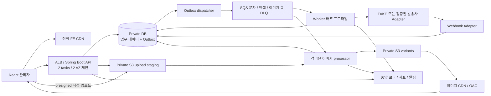
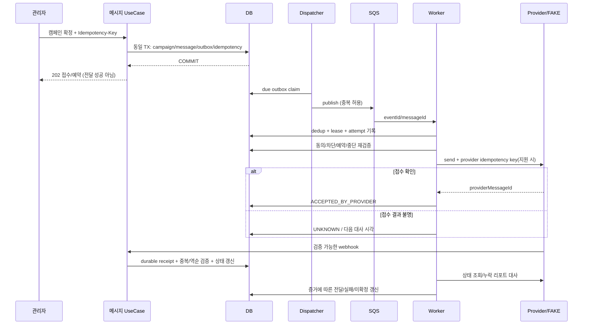
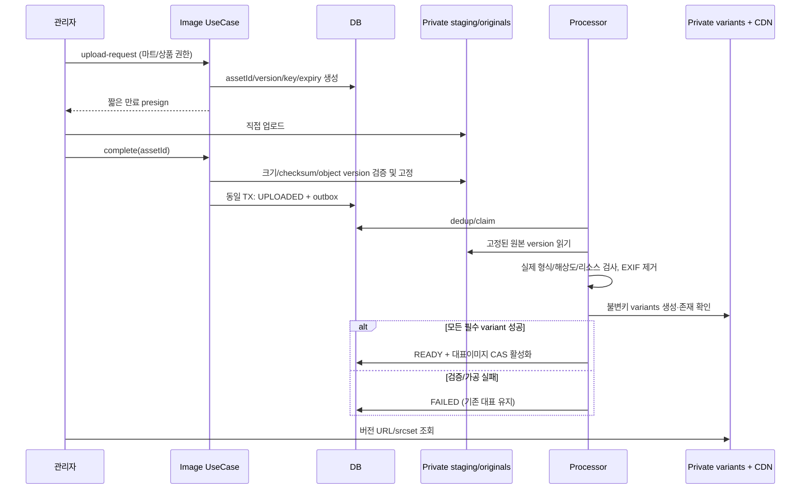

# Modular Monolith + Hexagonal Architecture

## 설계 범위

이 구조는 E01/E02의 요구를 구체화한 제안이며 배포된 시스템 현황이 아니다. React+TypeScript+Vite, Tailwind/shadcn/ui, TanStack Query/Table, RHF/Zod 및 Java 21+Spring Boot+Gradle을 기준으로 한다. 정확한 라이브러리/Boot 버전은 Phase 1에서 Java 21 호환성과 보안 지원을 검증해 고정한다. 기존 DB 조사 우선, 신규 DB 허용 시 PostgreSQL을 제안한다.

AWS는 참조 배포다. Multi-AZ DB·백업/PITR, private subnet, Secrets Manager, WAF, CloudWatch, IaC를 계획한다. API/worker는 같은 코드베이스의 실행 프로파일이고 독립 업무 서비스가 아니다. 초기 MSA/Kafka/Kubernetes/자체 이미지 서버/근거 없는 Redis는 사용하지 않는다. 로컬은 Compose의 DB/큐·스토리지 대체 환경과 FAKE provider로 주요 계약을 검증할 계획이며 제품 선정과 구현은 Phase 1 이후다.

## 모듈 경계와 소유권

| 모듈 | 소유 데이터·유스케이스 | 외부 의존 규칙 |
|---|---|---|
| mart/admin | mart, admin, role, permission, scope | 인증 Adapter에서 검증된 Principal을 application으로 전달 |
| product/category | product, category, 목록 Projection | 가격/재고는 각 모듈 공개 Port로 접근 |
| pricing | product_price, 검증된 가격 변경 | 묶음/세금/세일 규칙 확인 전 계산 미구현 |
| inventory | inventory 후보 | POS/주문 원장 확인 전 자동 차감 미설계 |
| image | asset/variant, 업로드·처리·활성화 | storage/processing Port; 상품 대표 교체는 공개 UseCase |
| messaging | campaign/message/attempt/consent/webhook | MessageSenderPort, DeliveryLookupPort, ClockPort |
| importjob | job/row/preview, bulk/import/export | 상품 공개 Command Port 호출; 테이블 직접 수정 금지 |
| audit | audit_log | 트랜잭션 참여 AuditPort; 민감값 필터 |
| delivery infrastructure | outbox/inbox/idempotency | publish/claim Adapter, 업무 규칙 소유 금지 |

계층 패키지는 명세의 `domain/{module}`, `application/port/{in,out}/{module}`, `application/service/{module}`, `adapter/in/web/...`, `adapter/out/persistence/{module}/{adapter,jpa,entity,mapper,query,projection}`, `adapter/out/{storage,smsprovider}`, `config`를 따른다. 단일 Gradle 애플리케이션으로 시작하고 모듈은 패키지 경계로 강제한다. domain은 JPA/Spring/SDK를 참조하지 않고 Adapter가 application Port를 구현한다. 모듈 간 Repository/JPA Entity 직접 참조를 금지하고 공개 UseCase 또는 이벤트를 사용한다. Phase 1에서 ArchUnit 등으로 의존 규칙을 검증한다.

## 트랜잭션·동시성

상품·가격 등 동시 변경이 필요한 단일 유스케이스는 같은 DB 트랜잭션으로 처리하고 감사/Outbox도 함께 기록한다. 모듈마다 독립 서비스 DB를 두지 않는다. 외부 HTTP·SQS 전송을 DB 트랜잭션 내부의 장기 작업으로 묶지 않는다. dispatcher는 lease/claim으로 행을 점유하고 게시 후 상태를 기록한다. 게시 성공 후 DB 기록 실패는 중복 게시 가능성이 있으므로 consumer가 event ID를 dedup한다.

worker는 짧은 트랜잭션에서 업무 실행권을 확보한다. 외부 SMS 호출과 로컬 커밋 사이의 실패는 로컬 inbox만으로 해결되지 않는다. 호출 전 attempt를 영속화하고 만료된 PROCESSING도 UNKNOWN으로 대사한다. DB lease+fencing token으로 오래된 worker의 결과 갱신을 거부하며 provider 멱등키 지원이 없으면 외부 호출 중복의 완전 제거를 보장하지 않는다. 재시도 시 기존 접수 여부 확인이 우선이다.

대량 작업은 행별 트랜잭션+행별 멱등키를 제안한다. 미리보기 당시 상품 version과 입력 hash를 저장하고 확정 시 만료·버전·권한을 재검증한다. 처리 직전에도 버전을 검사해 달라진 행은 충돌로 실패시킨다. 전체 원자성으로 표현하지 않고 부분 실패를 UI에 명시한다.

## 문자 시퀀스

예약 캠페인은 DB due 시각을 기준으로 scheduler가 실행 가능 메시지와 outbox를 claim한다. 대량 대상은 확정된 수신자 snapshot을 chunk 단위로 생성하고 진행 cursor/unique key로 재개한다. 캠페인 접수 트랜잭션에는 campaign+durable preparation outbox를 저장하며, 각 chunk 트랜잭션에 message+send outbox를 저장한다. 전체 수신자 수만큼 API 요청에서 행을 생성하지 않는다. 준비 작업도 유실 없이 복구하며, 202 응답은 준비 작업의 내구성 있는 접수를 뜻한다.

429/일시 오류도 발송사 계약상 ‘미접수’가 확인된 경우에만 자동 재발송한다. backoff+jitter, 최대 시도·예산·발송량 제한은 설정화한다. UNKNOWN은 무기한 숨기지 않고 대사 SLA/경고/담당자 판단으로 관리한다. DLQ redrive도 상태·동의·취소·기존 접수 증거를 재확인한다. 자동 타 발송사 failover는 기본 비활성이다.

웹훅은 서명/허용 발송사/시각 및 replay 정책을 검증한 뒤 receipt를 DB에 저장하고 ack한다. provider event ID 또는 검증된 대체 키로 dedup한다. 조기 웹훅은 receipt에 보류했다가 provider ID 매핑 후 재처리한다. 단순 상태 순서 숫자로 비교하지 않고 이벤트 시각·종류·제공업체 증거로 전이를 판정하며 충돌은 대사 대상으로 남긴다. PII 원문은 일반 로그에 남기지 않는다.

## 이미지 시퀀스

presigned URL은 그 자체로 일회용 토큰이라고 간주하지 않는다. staging 업로드 뒤 server-side copy 또는 S3 version ID로 원본을 고정해 재업로드 TOCTOU를 차단한다. copy와 DB 커밋은 분산 트랜잭션이 아니므로 고유 assetId로 재실행하고 orphan을 대사/GC한다. 임의 object key는 클라이언트가 지정할 수 없다. 처리 worker는 픽셀 수/메모리/시간/포맷 제한을 검증하며 SVG는 기본 거절한다.

variant 후보는 120/360/800/1200px WebP/JPEG이며 정확한 규격·업스케일 정책은 실이미지로 확정한다. 원본/staging은 CDN에서 접근할 수 없고 검증된 공개 variants 경로만 OAC origin으로 허용한다. 공개 불변 variant만 1년 immutable 캐시 후보이며 관리자 파일·엑셀 결과·원본은 별도 접근 정책이다.

상품에 `desired_image_asset_id`와 `active_image_asset_id`를 둔다. 새 업로드가 완료될 때 desired와 일치할 때만 active를 CAS 교체한다. 늦게 끝난 이전 업로드가 최신 이미지를 덮지 않는다. 원본 실패·처리 실패는 상품 API 장애로 전파하지 않는다. 이전 버전은 참조/보존/CDN 정책 확인 후 GC하고 긴급 삭제는 별도 purge 절차가 필요하다.

## ADR 초안

| ADR | 선택 | 대안 및 이유/재검토 조건 |
|---|---|---|
| 001 | 단일 배포 단위의 모듈러 모놀리스+worker 프로파일 | MSA보다 운영 부담이 적다는 요구 반영. 독립 확장 근거가 생길 때 재검토 |
| 002 | 순수 domain + Port/Adapter | SDK/JPA 결합 대신 교체·fake 검증 가능. 의미 없는 동일 인터페이스 복제 금지 |
| 003 | 기존 DB 우선, 허용 시 PostgreSQL | 즉시 DB 교체는 호환 위험. DDL·이관량 조사 후 확정 |
| 004 | DB Outbox+내구 큐+대사 | API 직발송/메모리 큐는 접수 유실·불확정 추적에 부적합 |
| 005 | private object storage+CDN+불변키 | 자체 파일서버·API byte proxy의 운영 부담 회피 |
| 006 | 행별 bulk 적용+버전 검증 | 장기 전체 TX 대신 부분 실패/재개 명시. 업무가 전체 원자성을 요구하면 재설계 |
| 007 | DB 기반 scope/lease, Redis 도입 보류 | 초기 구조 단순화. 실측 병목·분산 rate limit 요구 확인 후 재검토 |
| 008 | Phase 번호 0~6 유지, Phase 5 bulk·강화/6 전환 | PRD §10과 Prompt §9 차이를 분리. Prompt의 Phase 5 전환 내용은 5의 리허설과 6의 실전환으로 배치 |

API 목록과 ERD는 각각 [API 초안](api-spec.md), [ERD](data-model.md)에 정의해 중복을 줄인다. 결정 상태는 모두 ‘Phase 0 설계 제안’이며 운영 적합성 승인 전 배포 확정이 아니다.
