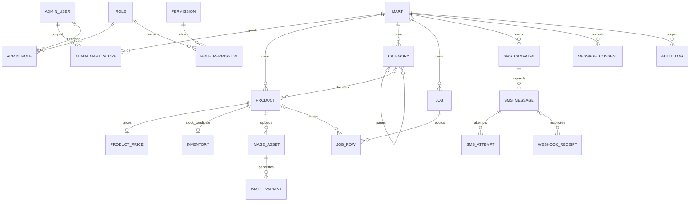

# DB ERD 및 데이터 모델 초안

신규 논리 모델 제안이다. 레거시 DDL과 매핑은 미확인이다. PostgreSQL 채택 가정으로 타입을 설명하며 실제 Flyway SQL은 작성하거나 실행하지 않는다. 브랜드, 주문/결제/배송/회원 상세, 재고 원장, 묶음/무배 계산은 조사 전 확정하지 않는다.

기술 공통 테이블 outbox_event, consumer_inbox, idempotency_record는 여러 업무 대상을 참조하므로 ERD에 가상 FK로 연결하지 않는다.

## 후보 테이블

| 테이블 | 주요 컬럼·타입 후보 | 제약·책임 |
|---|---|---|
| mart | id UUID, legacy_ref text, name, status | legacy_ref 고유 범위 조사 필요 |
| admin_user | id, external_subject, status | 인증 확정 후 subject unique |
| role / permission | id, code | code unique |
| admin_role / role_permission | admin_id/role_id, role_id/permission_id | 각 조합 unique |
| admin_mart_scope | admin_id, mart_id | 복합 PK; 전체 권한 암묵 부여 금지 |
| category | id, mart_id, parent_id, name | 동일 마트 부모 제약, 순환 방지; 공통 분류 여부 미확인 |
| product | id, mart_id, legacy_ref, category_id, code, barcode text, name, specification, min/max_order_qty, exposed/sold_out/popular, version bigint, desired/active_image_asset_id, created/updated_at | unique(mart_id,id); 바코드 unique는 미확정 |
| product_price | product_id, mart_id, regular_amount numeric(19,4), sale_amount, currency, version | 부동소수점 금지; 소수 자리·음수·세금·할인 규칙 미확인 |
| inventory | product_id, mart_id, quantity numeric, version | 후보만 정의. 단위·음수·예약·원장 확인 전 자동 차감 금지 |
| image_asset | id, mart_id, product_id, asset_version, staging_key, source_version/checksum, state, failure_code, expires_at | unique(product_id,asset_version), 고유 object key |
| image_variant | id, asset_id, width, format, object_key, checksum, state | unique(asset_id,width,format), unique object_key |
| job | id, mart_id, type, state, payload_hash, preview_token_hash, preview_expires_at, actor_id, counters, version | BULK/IMPORT/EXPORT; 확정 권한·미리보기 버전 기록 |
| job_row | id, job_id, mart_id, row_number, product_id nullable, expected_version, state, error_code, input/output_ref | unique(job_id,row_number), 대상 상품 동일 마트 |
| sms_campaign | id, mart_id, purpose, state, template_snapshot, sender_ref, scheduled_at, recipient_snapshot_ref, preparation_cursor, actor_id | 고정 대상·본문, 개인정보 보호, 분할 준비 재개 |
| sms_message | id, mart_id, campaign_id, recipient_ciphertext, recipient_fingerprint, state, local_key, provider, provider_message_id, next_action_at, lease_until, fencing_token, version | unique(mart_id,local_key); provider ID 고유 범위는 계약 확인 |
| sms_attempt | id, message_id, attempt_no, request_key, result_class, provider_ref, started/finished_at | unique(message_id,attempt_no), UNKNOWN 근거·상관 ID |
| message_consent | id, mart_id, recipient_fingerprint, purpose, status, effective_at, evidence_ref | 동의 이력 추가; 현재 동의 판단과 수신거부 우선순위 확정 필요 |
| webhook_receipt | id, provider, provider_event_key, message_id nullable, verified_at, occurred_at, processing_state, encrypted_payload_ref | unique(provider,provider_event_key); 조기·역순 이벤트 보존 |
| outbox_event | id, mart_id, aggregate_type/id, event_type, payload_ref, available_at, published_at, attempts, lease_until | 미게시/due 인덱스; 전화번호 등 평문을 큐에 싣지 않음 |
| consumer_inbox | consumer_name, event_id, state, processed_at | unique(consumer_name,event_id); 외부 실제 발송 exactly-once 보장 아님 |
| idempotency_record | actor_id, mart_id, operation, key, request_hash, resource_id, response_status, expires_at | unique(actor_id,mart_id,operation,key); 다른 payload의 키 재사용은 409 |
| audit_log | id, mart_id nullable, actor_id, action, target_type/id, before/after_redacted, job_id, trace_id, occurred_at | 추가 전용, 전역 작업 범위 명시, 개인정보 마스킹 |

## 정합성·인덱스·보존

모든 업무 행에 mart_id를 두고 부모와 `(mart_id,parent_id)` 복합 FK 또는 동등한 DB 제약으로 마트 간 참조를 차단한다. 서비스 scope 검증도 병행한다. 상품의 active/desired 이미지 참조는 `(mart_id,product_id,asset_id)`로 같은 상품 소속을 보장한다. 순환 FK의 DDL 순서는 Phase 1/3에서 설계한다.

numeric(19,4)는 저장 타입 후보이며 원화 소수 허용이라는 업무 결정이 아니다. 수량 타입 역시 단위 확인 후 확정한다. 상태 허용값은 CHECK 등으로 제한하고 전이는 유스케이스의 version/CAS로 검증한다. 상품·가격 동시 수정은 부모 product version으로 집계 전체의 충돌을 판정한다.

인덱스 후보: product(mart_id,updated_at,id), (mart_id,barcode), (mart_id,category_id,id), job(mart_id,created_at,id), sms_message(state,next_action_at), audit_log(mart_id,occurred_at,id). 부분일치 검색과 상태 필터는 실제 쿼리·데이터로 검증한 뒤 추가한다.

시각은 UTC timestamptz 후보, 화면은 KST다. 레거시 시각대가 불명확하면 임의 변환하지 않는다. 구·신 ID 매핑을 유지하고 바코드는 숫자 변환하지 않는다. 물리/논리 삭제, 익명화, 보관기간은 미확정이다.

Outbox/inbox/멱등키 보존은 API 재전송·큐 재배달·DLQ 보류·발송사 조회 기간을 함께 고려한다. 키 만료 후에도 메시지 업무 상태로 재발송을 방어한다. 개인정보 암호화 키, 검색 fingerprint용 HMAC 키, 결과 파일 보관은 Phase 1/4 운영 결정이다.

## 마이그레이션

Flyway forward migration, expand→backfill→전환→contract를 별도 릴리스로 분리한다. 현재 DB 변경은 없다. 가격/재고/바코드/이미지/동의 매핑과 예외 행을 기록하고 건수·고유성·금액·참조·체크섬으로 대사한다. [전환 계획](migration-plan.md)을 따른다.
